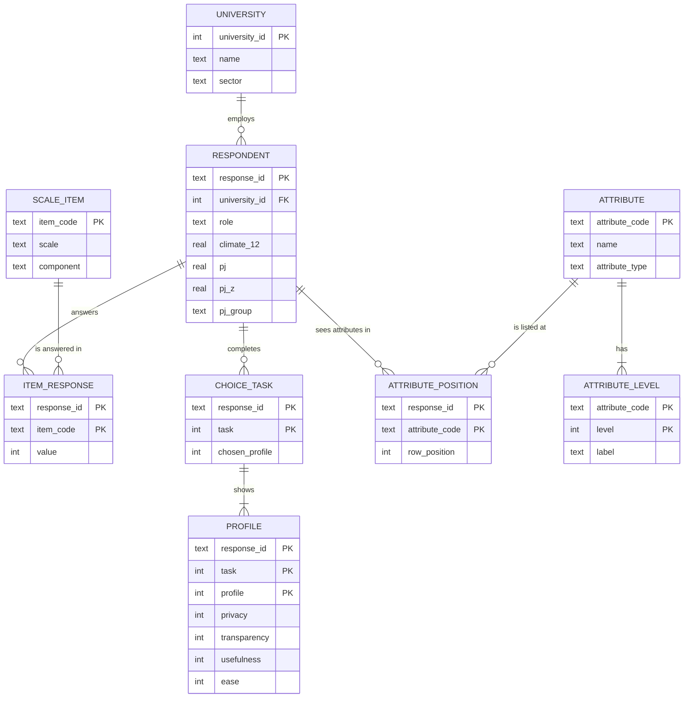

# Relational database of the clean study data

A SQLite database that brings the clean data of all three stages into one relational structure. The build script loads the outputs of the Stage 1, 2 and 3 preparation scripts, enforces the schema's keys and constraints, and checks that the database reproduces the clean files exactly before writing it. The example queries reproduce figures reported in Chapters 3 to 5.

The database itself is not included in this repository. Responses were collected anonymously under King's College London ethics approval MRSP-24/25-49508, and the data are held under restricted access.

## Contents

| File | Purpose |
|---|---|
| `schema.sql` | Tables, keys, constraints, indexes and views |
| `build_database.py` | Builds and verifies the database from the clean data of Stages 1 to 3 |
| `queries.sql` | Example queries, each reproducing a figure reported in the thesis |
| `run_queries.py` | Runs every query in `queries.sql` and prints the results |
| `requirements.txt` | Package versions used |

## How to run

The database is built from the outputs of the three stages, so their preparation scripts are run first (see the README in each stage folder). The build uses only the Python standard library and pandas.

```bash
python build_database.py --stage1 ../stage1/data --stage2 ../stage2/data --stage3 ../stage3/data --out data/thesis.db
python run_queries.py --db data/thesis.db
```

The queries can also be run in any SQLite client, for example `sqlite3 data/thesis.db < queries.sql`.

## Structure



| Table or view | Rows | Content |
|---|---|---|
| `university` | 8 | Participating universities and their sector |
| `respondent` | 317 | One row per respondent in the analytic sample, with role, background, scale composites, subgroup variables and conjoint design version |
| `scale_item` | 20 | The twelve climate items, seven expected procedural justice items and the attention check |
| `item_response` | 6,340 | One row per respondent and item |
| `attribute`, `attribute_level` | 4, 12 | Conjoint attributes and their level labels |
| `attribute_position` | 1,268 | Row of the profile table in which each respondent saw each attribute |
| `choice_task` | 2,853 | One row per respondent and task, with the profile chosen |
| `profile` | 5,706 | One row per profile shown, with the level of each attribute |
| `profile_choice` (view) | 5,706 | Profiles with the outcome, 1 if chosen and 0 if not |
| `profile_attribute_level` (view) | 22,824 | One row per profile and attribute, with the level label |
| `respondent_profile` (view) | 317 | Respondents with their university and sector |

## Integrity checks

The build stops with an error unless every one of the following holds.

1. All foreign keys resolve and every value satisfies its constraint.
2. Each table holds the expected number of rows.
3. The choices, rebuilt through the `profile_choice` view, match the Stage 2 choice data for every profile.
4. The climate and expected procedural justice composites, recomputed in SQL from the item table, match the Stage 1 composites.
